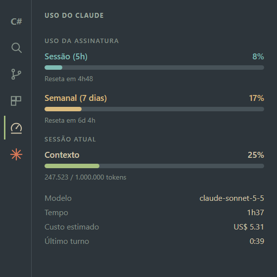
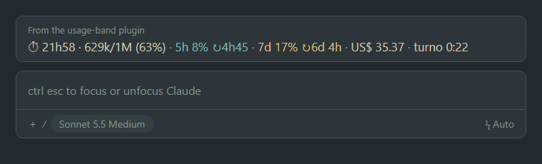

<p align="center">
  
</p>

<p align="center">
  
  
  
  
  
</p>

**Claude Usage: Limits, Context & Cost** é uma extensão para **VS Code** e **Antigravity** que mostra, na barra de status, o uso da sessão atual do **Claude Code**: tempo decorrido, tokens de contexto, **limites de 5h e 7d da assinatura**, custo estimado e duração do turno. Um clique abre um painel lateral com barras de progresso. As cores seguem o **tema do editor**.

> 🇬🇧 **English:** Extension for **VS Code 1.82+** and **Antigravity** that shows the current Claude Code session in the status bar — elapsed time, context tokens, 5-hour / 7-day subscription limits, estimated cost and last-turn duration — plus a sidebar panel with progress bars. Colors follow your editor theme. It reads local transcripts in `~/.claude/projects`. The 5h/7d limits come from Anthropic's (undocumented) usage endpoint, queried only after you allow it on first run: the extension then reads Claude Code's OAuth token (credentials file, or the Keychain on macOS) and polls about once a minute while Claude is in use (every 5 minutes when idle), once per machine, shared across windows and editors. No telemetry. Download the `.vsix` from [Releases](https://github.com/AlessandroLobo/claude-usage-statusbar/releases). Cost is an estimate based on public API prices, not your actual bill. Unofficial project, not affiliated with Anthropic.

## Compatibilidade

| Editor | Situação |
| --- | --- |
| **VS Code 1.82 ou mais novo** | ✅ Suportado |
| **Antigravity** | ✅ Suportado (onde a extensão é usada no dia a dia) |
| Cursor, Windsurf, VSCodium | Devem funcionar (mesma base do VS Code), sem teste |
| VS Code anterior ao 1.82 | ❌ O editor recusa a instalação |

| Sistema | Situação |
| --- | --- |
| Windows | ✅ Testado |
| Linux | Deve funcionar (mesmos caminhos do Windows), sem teste |
| macOS | Deve funcionar; o token é lido do **Keychain**, onde o Claude Code o guarda no Mac. Sem teste |

**Requisito:** o **Claude Code** instalado e com login feito (CLI ou extensão). A extensão lê o que ele grava em `~/.claude`.

## Como fica

<p align="center">
  
</p>

A barra tem quatro itens, sempre juntos: **tempo e contexto**, **5h**, **7d** e **custo e turno**. Os limites de 5h e 7d têm cor própria para você achar um e outro de relance, e as cores mudam quando algo se aproxima do limite (veja [Cores](#cores)).

Passe o mouse para ver os detalhes (modelo, contexto exato, custo, totais de tokens e limites):

<p align="center">
  
</p>

O painel **Claude Usage** tem **ícone próprio na barra de atividades** (a coluna de ícones à esquerda), sempre visível e clicável como os demais. Clicar no ícone — ou em qualquer item da barra de status — abre o painel, com barras para a sessão de 5h, a semana e o contexto; um novo clique fecha a barra lateral:

<p align="center">
  
</p>

Captura real no Antigravity (versão anterior às cores próprias de 5h/7d):

<p align="center">
  
</p>

> As imagens, exceto a captura real, são ilustrações no tema Everforest; no seu editor, as cores vêm do tema que você usa.

## O que cada campo significa

Exemplo: `🕒 16h57 · 543k/1M (54%)` · `5h 8% ↻4h03` · `7d 2% ↻6d 14h` · `US$ 26.89 · turno 2:45`

| Campo | O que significa |
| --- | --- |
| 🕒 `16h57` | **Tempo da sessão**: desde a primeira mensagem desta conversa do Claude Code. Volta a zero numa conversa nova. |
| `543k/1M (54%)` | **Contexto**: tokens que o Claude está "lembrando" agora, de uma janela de 1 milhão. A partir de **80%** fica laranja; perto de 100%, use `/compact` ou abra uma conversa nova. |
| `5h 8% ↻4h03` | **Limite de 5 horas** da assinatura (azul): uso e tempo até a janela reiniciar. A partir de **90%** fica vermelho. |
| `7d 2% ↻6d 14h` | **Limite semanal** (amarelo): uso e tempo até reiniciar. A partir de **90%** fica vermelho. |
| `(há 16m)` | Aparece ao lado dos limites quando a última leitura tem mais de 10 minutos. |
| `5h –` | A janela reiniciou e a nova leitura ainda não chegou (por exemplo, enquanto a API pede para esperar). Volta ao valor real na próxima consulta. |
| `US$ 26.89` | **Custo estimado** da sessão pela tabela de preços da API, somando subagentes. Serve para medir consumo — na assinatura, não é o valor cobrado. |
| `turno 2:45` | **Duração da última resposta** do Claude, do envio até terminar; `▶` enquanto ele ainda está respondendo. |

**Passe o mouse** para ver o detalhe (modelo, contexto exato, custo com 4 casas, totais de tokens e hora da leitura dos limites) e **clique** para abrir o painel com barras.

| Atualização | Frequência |
| --- | --- |
| Tempo, contexto, custo e turno | a cada 5 s |
| Limites 5h/7d | a cada 1 min enquanto você usa o Claude; a cada 5 min com ele parado |

## Cores

A cor acompanha o uso: cada limite começa na sua **cor-base** e vai mudando aos poucos até o vermelho conforme a porcentagem sobe. Vale para a barra de status e para o painel.

| Uso | Cor |
| --- | --- |
| até **50%** | a cor-base (5h e 7d: `charts.green`, do tema ativo) |
| de 50% a **75%** | da cor-base ao âmbar, aos poucos |
| de 75% a **90%** | do âmbar ao vermelho, aos poucos |
| a partir de **90%** | vermelho, com o fundo de aviso do tema (`statusBarItem.warningBackground`) quando o tema define um diferente da barra |

- O **contexto** não tem cor-base: fica na cor padrão da barra até 75% e só então vai do âmbar ao vermelho. No painel, a barra de contexto parte do verde (`charts.green`).
- Até 50% a cor acompanha o **tema ativo**. Acima disso a mistura usa um hexadecimal aproximado da cor do tema; para o tom exato nos dois lados, informe um hexadecimal. Ids de cor fora de `charts.blue`, `green`, `yellow`, `orange`, `purple` e `red` não podem ser misturados e ficam como estão até o âmbar.
- Para trocar as cores-base de 5h e 7d, use `claudeUsageBar.colorSession5h` e `claudeUsageBar.colorWeekly7d` com um id de cor do tema ou um hexadecimal (`#7fbbb3`). Deixe vazio para usar a cor padrão da barra. O 5h e o 7d usam o mesmo verde do contexto; antes eram azuis (e, antes da 0.10, o 7d era amarelo).
- As faixas ficam em `claudeUsageBar.colorGradientStart`, `colorGradientAmber` e `colorGradientRed` (padrão 50, 75 e 90; precisam estar em ordem crescente, senão valem os padrões).
- Com `claudeUsageBar.colorGradient` em `false` a cor volta a ser fixa: 5h e 7d na cor-base, contexto laranja a partir de 80% e limites vermelhos a partir de 90%.

## Instalação

### 1. Instalar a extensão

**Pela loja (recomendado — atualiza sozinho):**

| Editor | Onde | Como |
| --- | --- | --- |
| **VS Code** | [Visual Studio Marketplace](https://marketplace.visualstudio.com/items?itemName=alessandrolobo.claude-usage-statusbar-metric) | Aba de Extensões → busque **Claude Usage: Limits, Context & Cost** → **Install** |
| **Antigravity, Cursor, Windsurf, VSCodium** | [Open VSX](https://open-vsx.org/extension/alessandrolobo/claude-usage-statusbar-metric) | Aba de Extensões → busque o mesmo nome → **Install** |

O ID da extensão é `alessandrolobo.claude-usage-statusbar-metric`; na linha de comando, `code --install-extension alessandrolobo.claude-usage-statusbar-metric` (no Antigravity, `antigravity-ide --install-extension ...`). Se não encontrar pelo nome, busque pelo ID.

**Ou pelo `.vsix` do GitHub** (abaixo), que não atualiza sozinho.

**Pelo editor (VS Code ou Antigravity):**

1. Baixe o `.vsix` mais recente em [Releases](https://github.com/AlessandroLobo/claude-usage-statusbar/releases).
2. `Ctrl+Shift+P` → **Extensions: Install from VSIX…** → escolha o arquivo.
3. `Ctrl+Shift+P` → **Developer: Reload Window**.

**Por linha de comando** — o mesmo comando instala e atualiza, e sempre baixa a versão mais recente:

| Editor | Windows (PowerShell) |
| --- | --- |
| **VS Code** | `iwr https://github.com/AlessandroLobo/claude-usage-statusbar/releases/latest/download/claude-usage-statusbar.vsix -OutFile $env:TEMP\cub.vsix; code --install-extension $env:TEMP\cub.vsix --force` |
| **Antigravity** | `iwr https://github.com/AlessandroLobo/claude-usage-statusbar/releases/latest/download/claude-usage-statusbar.vsix -OutFile $env:TEMP\cub.vsix; antigravity-ide --install-extension $env:TEMP\cub.vsix --force` |

Linux/macOS (Bash):

```bash
curl -fL -o /tmp/cub.vsix https://github.com/AlessandroLobo/claude-usage-statusbar/releases/latest/download/claude-usage-statusbar.vsix \
  && code --install-extension /tmp/cub.vsix --force        # no Antigravity: antigravity-ide (ou antigravity)
```

Com o `.vsix` já baixado, no Windows, o script instala em **todos** os editores que encontrar (VS Code e Antigravity):

```powershell
powershell -ExecutionPolicy Bypass -File .\Instalar.ps1
```

Depois de instalar por linha de comando, use **Developer: Reload Window** no editor.

> **Perfis do VS Code:** a linha de comando instala no perfil **padrão**. Se a janela usa outro perfil (nome no canto inferior esquerdo, no ícone de engrenagem), acrescente `--profile "Nome do perfil"` ao comando — ou instale pelo **Install from VSIX…**, que usa o perfil da janela aberta.

### 2. Ativar os limites de 5h/7d

Na primeira execução aparece o aviso abaixo. Clique em **Ativar**:

> *Claude Usage: mostrar os limites de 5h e 7d da sua assinatura? Para isso a extensão lê o token do Claude Code neste computador e consulta a API de uso da Anthropic (a cada minuto enquanto você usa o Claude). Nada é enviado a outro lugar.* — **Ativar** · **Agora não**

O aviso aparece **uma única vez** por editor. Fechar no X, deixar sumir ou clicar em *Agora não* tem o mesmo efeito: os limites não aparecem, a extensão não lê o token nem usa a rede, e o aviso **não volta**. O restante (tempo, contexto, custo e turno) funciona normalmente. Para ativar depois:

- clique no link **ativar os limites 5h/7d** que o painel *Claude Usage* mostra no lugar das barras;
- ou rode `Ctrl+Shift+P` → **Claude Usage: Ativar limites 5h/7d**;
- ou, se o aviso só sumiu da tela, abra-o pelo **sino de notificações** no canto inferior direito.

### 3. Mandar a primeira mensagem

Tempo, contexto, custo e turno vêm do histórico que o Claude Code grava para a **pasta aberta**, e esse histórico só existe depois da primeira mensagem. Numa pasta sem conversa, a barra mostra apenas os limites 5h/7d — mande uma mensagem ao Claude e o restante aparece em segundos.

## Usando junto com o plugin `usage-band`

As versões mais novas da extensão do Claude Code para o editor já desenham a barra do plugin [usage-band](https://github.com/AlessandroLobo/alessandrolobo-usage-band) acima do campo de mensagem (a etiqueta *From the usage-band plugin* identifica a barra). As versões mais antigas não desenham, e foi para esse caso que esta extensão foi criada.

<p align="center">
  
</p>

| | Plugin (acima do prompt) | Esta extensão (barra de status) |
| --- | --- | --- |
| Dados | ao vivo, a cada resposta, direto do Claude Code | consulta à API a cada 1 a 5 min |
| Custo | real, somado pelo Claude Code | estimado pela tabela de preços |
| Rede e token | nenhum | lê o token e consulta a API (com sua autorização) |
| Onde aparece | só na conversa do Claude Code | o tempo todo, em qualquer arquivo |

Dá para usar os dois ao mesmo tempo ou só um deles — veja [Onde mostrar](#onde-mostrar). Se quiser apenas o plugin, desative esta extensão e os limites passam a vir do próprio Claude Code, sem consulta à API.

## Onde mostrar

Você escolhe onde ver o uso. Cada lugar tem o seu interruptor:

| Quero ver | Barra de status (esta extensão) | Acima do chat (plugin `usage-band`) |
| --- | --- | --- |
| **Só na barra de baixo** | ligada | desligada |
| **Só acima do chat** | desligada | ligada |
| **Nos dois** (padrão) | ligada | ligada |

**Barra de status (esta extensão):** `Ctrl+,` → busque **Claude Usage** → desmarque **Show Status Bar**; ou no `settings.json`:

```json
"claudeUsageBar.showStatusBar": false
```

A mudança vale na hora, sem reiniciar. O ícone e o painel lateral continuam disponíveis.

**Acima do chat (plugin):** no Claude Code, `/plugin` → **usage-band** → **Configure** → desligue **Mostrar a barra acima do prompt**. (Pelo terminal: `claude plugin configure usage-band`.) Para esconder só na sessão atual, use `/uso`. Exige o plugin na versão 0.3.0 ou mais nova.

Se preferir ver o uso apenas acima do chat, desligue a barra de status; a consulta de limites da extensão só é necessária se você quiser a barra de baixo ou o painel.

## De onde vêm os limites de 5h/7d

Depois da autorização, a própria extensão consulta a API de uso da Anthropic (`https://api.anthropic.com/api/oauth/usage`):

| | |
| --- | --- |
| **Token** | Lido de `~/.claude/.credentials.json` (Windows/Linux) ou do **Keychain** (macOS). Somente leitura: nunca é gravado, registrado nem enviado a outro destino que não a API da Anthropic. Token prestes a vencer não é usado — o Claude Code o renova sozinho. |
| **Frequência** | **Enquanto você usa o Claude**, a cada **1 min** (`claudeUsageBar.activeRefreshSeconds`, mínimo 30 s): a cada nova resposta do Claude depois da última leitura, os limites são consultados de novo, respeitando esse espaçamento. **Com o Claude parado**, a cada **5 min** (`claudeUsageBar.directRefreshMinutes`, mínimo 3). Sempre **uma consulta por computador**: as janelas abertas — inclusive VS Code e Antigravity ao mesmo tempo — dividem o resultado em `~/.claude-usage-statusbar/usage.json`, e uma trava garante que só uma delas consulte. Ao voltar para a janela, os números são conferidos na hora. |
| **Limitação da API** | Em HTTP 429 a extensão espera o `Retry-After` (ou recua sozinha, até 60 min) e continua mostrando a última leitura, com a idade. |
| **Idade** | Leituras com mais de 10 min aparecem com a idade (`5h 14% ↻4h09 (há 16m)`); com mais de 30 min (`limitsStaleMinutes`) ou janela já reiniciada, não são exibidas. |
| **Erros** | O painel mostra o último erro (token recusado, falha de rede, 429…). |

O endpoint **não é documentado** pela Anthropic: pode mudar sem aviso. Os limites podem ficar até cerca de 1 minuto atrás do painel de conta da extensão do Claude Code, que recebe os valores a cada resposta. Consultas mais frequentes não são recomendadas: o endpoint limita o número de chamadas, e um HTTP 429 deixaria os limites parados por até 60 min.

**Opcional:** se a extensão [Claude Usage Meter](https://open-vsx.org/extension/shivakrishnakokkula/claude-usage-meter) estiver instalada, a leitura dela também é aproveitada (vale a mais recente). Ela **não é necessária**.

## Atualização

| Como você instalou | Como atualizar |
| --- | --- |
| `.vsix` (Releases) | **Manual:** rode de novo o [comando de instalação](#1-instalar-a-extensão) do seu editor e use *Developer: Reload Window*. O editor não avisa que há versão nova — acompanhe a página de [Releases](https://github.com/AlessandroLobo/claude-usage-statusbar/releases) (*Watch → Custom → Releases* avisa por e-mail). |
| Open VSX / Marketplace (quando publicada lá) | **Automática:** o editor atualiza sozinho ou em *Extensões → Atualizar*. |

As configurações `claudeUsageBar.*` e a autorização dos limites são mantidas na atualização. Quem não atualizar continua com a versão que tem, funcionando normalmente — só não recebe as novidades.

## Como funciona

A cada 5 segundos, a extensão localiza o transcript mais recente do Claude Code para a pasta aberta (`~/.claude/projects/<pasta>/*.jsonl`, respeitando `CLAUDE_CONFIG_DIR`) e lê **apenas o trecho acrescentado** desde a última leitura. Contexto, tempo e turno vêm dos registros da sessão; o custo é calculado pelos `usage` de cada resposta e a [tabela de preços](#preços-usados-no-custo-us-por-1m-de-tokens), incluindo os transcripts de subagentes. Mensagens repetidas no arquivo (mesmo `id`) são contadas uma vez. Os limites 5h/7d vêm da consulta descrita [acima](#de-onde-vêm-os-limites-de-5h7d).

Sem dependências e sem telemetria. Rede: só a consulta de uso à API da Anthropic, e só depois de autorizada.

## Comandos

| Comando | Ação |
| --- | --- |
| `Claude Usage: Abrir/fechar painel de uso` | Abre e foca o painel lateral; se ele já estiver visível, fecha a barra lateral (o mesmo vale ao clicar em qualquer item da barra) |
| `Claude Usage: Ativar limites 5h/7d (consulta à API de uso)` | Autoriza a consulta dos limites (mesmo efeito do **Ativar** do aviso) |
| `Claude Usage: Atualizar agora` | Força a atualização |
| `Claude Usage: Mostrar/ocultar barra` | Alterna a visibilidade |

## Configurações

| Chave | Padrão | Descrição |
| --- | --- | --- |
| `claudeUsageBar.showStatusBar` | `true` | Mostra os itens na barra de status (veja [Onde mostrar](#onde-mostrar)) |
| `claudeUsageBar.contextWindow` | `0` | Janela de contexto em tokens. `0` = automático pelo modelo |
| `claudeUsageBar.refreshSeconds` | `5` | Intervalo de atualização da barra |
| `claudeUsageBar.showCost` | `true` | Mostra o custo estimado |
| `claudeUsageBar.showTurn` | `true` | Mostra a duração do turno |
| `claudeUsageBar.showSessionTime` | `true` | Mostra o tempo da sessão |
| `claudeUsageBar.showLimits` | `true` | Mostra os limites 5h/7d na barra |
| `claudeUsageBar.colorSession5h` | `charts.green` | Cor do limite de 5h (veja [Cores](#cores)) |
| `claudeUsageBar.colorWeekly7d` | `charts.green` | Cor-base do limite de 7d (veja [Cores](#cores)) |
| `claudeUsageBar.colorGradient` | `true` | Muda a cor aos poucos até o vermelho conforme o uso sobe (veja [Cores](#cores)) |
| `claudeUsageBar.colorGradientStart` | `50` | Uso (%) em que a cor começa a sair da cor-base |
| `claudeUsageBar.colorGradientAmber` | `75` | Uso (%) em que a cor chega ao âmbar |
| `claudeUsageBar.colorGradientRed` | `90` | Uso (%) a partir do qual a cor é vermelha e o alerta de fundo liga |
| `claudeUsageBar.fetchLimitsDirectly` | `false` | Consulta dos limites à API de uso; ligada pelo **Ativar** do aviso |
| `claudeUsageBar.activeRefreshSeconds` | `60` | Espaçamento das consultas enquanto o Claude está em uso (mínimo 30) |
| `claudeUsageBar.directRefreshMinutes` | `5` | Intervalo das consultas com o Claude parado (mínimo 3) |
| `claudeUsageBar.limitsStaleMinutes` | `30` | Idade máxima da leitura dos limites; acima de 10 min ela aparece com a idade |
| `claudeUsageBar.refreshLimits` | `true` | Com a `claude-usage-meter` (opcional) ativa e a consulta direta desligada, pede a ela uma leitura nova após 6 min |
| `claudeUsageBar.limitsSnapshotPath` | `""` | Snapshot da `claude-usage-meter` opcional (vazio = `~/.claude-usage-meter/usage-snapshot.json`) |

## Preços usados no custo (US$ por 1M de tokens)

| Modelo | Entrada | Saída |
| --- | --- | --- |
| Fable / Mythos | 10 | 50 |
| Opus 5.5 | 4 | 20 |
| Opus 5 / 4.8 / 4.7 / 4.6 | 5 | 25 |
| Sonnet 5.5 / 5 | 2 | 10 |
| Sonnet 4.6 | 3 | 15 |
| Haiku 5.5 | 0,10 (0,50 acima de 100K de prompt) | 0,50 (2,50 acima de 100K) |
| Haiku 4.5 | 1 | 5 |

Cache: leitura a 0,1× da entrada (Opus 5.5: 0,05×; Fable: 0,025×); escrita a 1,25× (5 min) e 2× (1 h). A tabela fica em `core.js` (`PRICES`) — atualize quando os preços mudarem. É uma **estimativa**: não substitui sua fatura.

## Desenvolvimento

```powershell
node test.js                       # testes da lógica (sem VS Code)
npx --yes @vscode/vsce package     # gera o .vsix
```

`core.js` tem a lógica pura (leitura incremental, custo, formatação, painel); `direct.js`, a consulta compartilhada dos limites (trava, cache, credenciais); `extension.js` só cria os itens da barra, o painel e o aviso.

### Publicar uma versão nova

1. Aumente `version` no `package.json` (sem aumentar, o editor não reconhece como atualização) e **não mude** `publisher`/`name`, que formam o ID da extensão.
2. `git add -A && git commit -m "feat: ..." && git push`
3. `git tag vX.Y.Z && git push origin vX.Y.Z` — o workflow `release.yml` roda o teste, gera o `.vsix` e cria o Release com `claude-usage-statusbar-metric-X.Y.Z.vsix` e `claude-usage-statusbar.vsix` (nome fixo usado pelo comando de instalação).
4. Avise quem instalou por `.vsix` para repetir o comando de atualização.

## Privacidade e aviso

A extensão lê arquivos locais (`~/.claude` e, se existir, o snapshot da `claude-usage-meter`). Depois que você autoriza, também lê o token do Claude Code e consulta a API de uso da Anthropic — nenhum outro destino, nenhuma telemetria. Sem a autorização, não usa a rede. Projeto não oficial, sem vínculo com a Anthropic. Licença [MIT](LICENSE).
