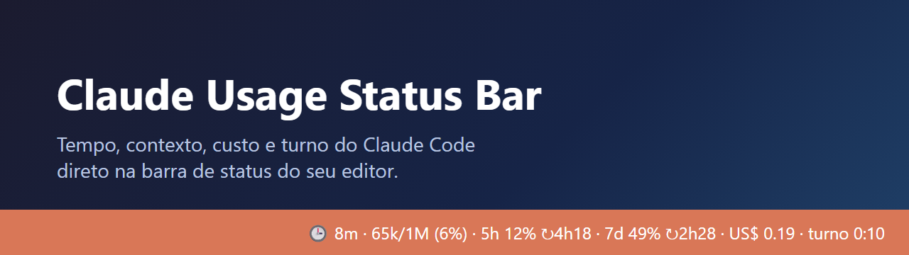
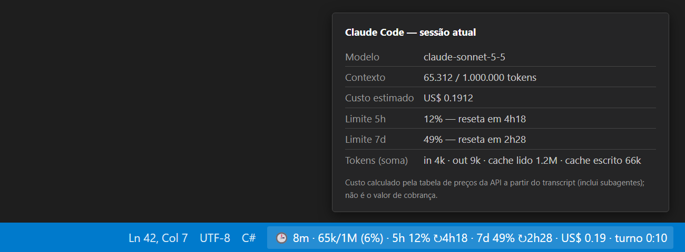
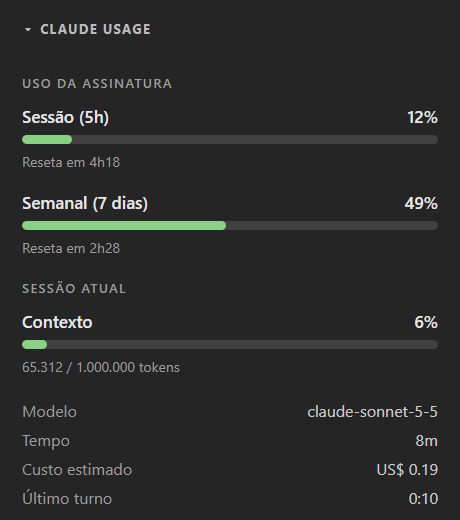

<p align="center">
  
</p>

<p align="center">
  
  
  
  
</p>

**Claude Usage Status Bar** mostra, na barra de status do VS Code ou do Antigravity, o uso da sessão atual do **Claude Code**: tempo decorrido, tokens de contexto, **limites de 5h e 7d da assinatura**, custo estimado e duração do turno. Ao clicar, abre um painel lateral com barras de progresso.

> 🇬🇧 **English:** VS Code / Antigravity extension that shows the current Claude Code session in the status bar — elapsed time, context tokens, 5-hour / 7-day subscription limits, estimated cost and last-turn duration, plus a sidebar panel with progress bars. The 5h/7d limits are optional and come from the shared snapshot of the `claude-usage-meter` extension. It only reads local transcripts in `~/.claude/projects`: no network access, no telemetry. Download the `.vsix` from [Releases](https://github.com/AlessandroLobo/claude-usage-statusbar/releases) and use *Extensions: Install from VSIX…*. Cost is an estimate based on public API prices, not your actual bill. Unofficial project, not affiliated with Anthropic.

## Como fica

<p align="center">
  
</p>

Passe o mouse para ver os detalhes (modelo, contexto exato, custo e totais de tokens):

<p align="center">
  
</p>

O clique no item abre o painel **Claude Usage** no Explorer, com barras para a sessão de 5h, a semana e o contexto:

<p align="center">
  
</p>

Quando o contexto passa de **80%** (ou algum limite passa de **90%**), o item ganha fundo de aviso, para você compactar ou abrir uma nova sessão antes de estourar a janela:

<p align="center">
  
</p>

> A primeira imagem é uma captura real no Antigravity; o tooltip, o painel e o aviso são ilustrações do visual. As cores seguem o tema do seu editor.

## O que cada campo significa

| Campo | Significado |
| --- | --- |
| 🕒 `8m` | Tempo desde o início da sessão |
| `65k/1M (6%)` | Tokens de contexto da última resposta / janela do modelo |
| `5h 12% ↻4h18` | Uso do limite de 5 horas e tempo até reiniciar |
| `7d 49% ↻2h28` | Uso do limite semanal e tempo até reiniciar |
| `US$ 0.19` | Custo **estimado** da sessão, somando subagentes |
| `turno 0:10` | Duração do último turno; `▶` enquanto o turno está em andamento |

### De onde vêm os limites de 5h/7d

Eles **não** são calculados pela extensão: vêm do snapshot compartilhado `~/.claude-usage-meter/usage-snapshot.json`, mantido pela extensão [Claude Usage Meter](https://marketplace.visualstudio.com/items?itemName=shivakrishnakokkula.claude-usage-meter) (que consulta a API da Anthropic). Esta extensão só **lê o arquivo** — não faz chamadas de rede e não toca em credenciais. Sem a `claude-usage-meter`, tudo continua funcionando, apenas sem os campos 5h/7d. Leituras com mais de 15 minutos (configurável) e janelas já reiniciadas não são exibidas, para nunca mostrar um número velho como se fosse atual.

## Instalação

1. Baixe o `.vsix` mais recente em [Releases](https://github.com/AlessandroLobo/claude-usage-statusbar/releases).
2. No editor: `Ctrl+Shift+P` → **Extensions: Install from VSIX…** → escolha o arquivo.
3. `Ctrl+Shift+P` → **Developer: Reload Window**.

Pela linha de comando (Windows), com o `.vsix` na pasta, o script instala no Antigravity e no VS Code que encontrar:

```powershell
powershell -ExecutionPolicy Bypass -File .\Instalar.ps1
```

Ou direto: `antigravity-ide --install-extension claude-usage-statusbar-0.2.0.vsix` (ou `code --install-extension ...`).

> A extensão oficial do Claude Code para o editor não desenha barras de plugin (`AbovePrompt`/`ui_render`); por isso esta extensão lê o transcript da sessão em vez de depender do plugin.

## Como funciona

A cada 5 segundos, a extensão localiza o transcript mais recente em `~/.claude/projects/<pasta-aberta>/*.jsonl` (respeita `CLAUDE_CONFIG_DIR`) e lê **apenas o trecho acrescentado** desde a última leitura. Contexto, tempo e turno vêm dos registros da sessão; os limites 5h/7d vêm do snapshot da `claude-usage-meter`; o custo é calculado pelos `usage` de cada resposta e a tabela de preços abaixo, incluindo os transcripts de subagentes. Mensagens repetidas no arquivo (mesmo `id`) são contadas uma vez.

Sem dependências, sem rede, sem telemetria.

## Comandos

| Comando | Ação |
| --- | --- |
| `Claude Usage: Abrir painel de uso` | Foca o painel lateral (também ao clicar no item da barra) |
| `Claude Usage: Atualizar agora` | Força a atualização |
| `Claude Usage: Mostrar/ocultar barra` | Alterna a visibilidade |

## Configurações

| Chave | Padrão | Descrição |
| --- | --- | --- |
| `claudeUsageBar.contextWindow` | `0` | Janela de contexto em tokens. `0` = automático pelo modelo |
| `claudeUsageBar.refreshSeconds` | `5` | Intervalo de atualização |
| `claudeUsageBar.showCost` | `true` | Mostra o custo estimado |
| `claudeUsageBar.showTurn` | `true` | Mostra a duração do turno |
| `claudeUsageBar.showSessionTime` | `true` | Mostra o tempo da sessão |
| `claudeUsageBar.showLimits` | `true` | Mostra os limites 5h/7d na barra |
| `claudeUsageBar.limitsStaleMinutes` | `15` | Idade máxima da leitura dos limites |
| `claudeUsageBar.limitsSnapshotPath` | `""` | Caminho do snapshot (vazio = `~/.claude-usage-meter/usage-snapshot.json`) |

## Preços usados no custo (US$ por 1M de tokens)

| Modelo | Entrada | Saída |
| --- | --- | --- |
| Fable / Mythos | 10 | 50 |
| Opus 5.5 | 4 | 20 |
| Opus 5 / 4.8 / 4.7 / 4.6 | 5 | 25 |
| Sonnet 5.5 / 5 | 2 | 10 |
| Sonnet 4.6 | 3 | 15 |
| Haiku 5.5 | 0,10 (0,50 acima de 100K de prompt) | 0,50 (2,50 acima de 100K) |
| Haiku 4.5 | 1 | 5 |

Cache: leitura a 0,1× da entrada (Opus 5.5: 0,05×; Fable: 0,025×); escrita a 1,25× (5 min) e 2× (1 h). A tabela fica em `core.js` (`PRICES`) — atualize quando os preços mudarem. É uma **estimativa**: não substitui sua fatura.

## Desenvolvimento

```powershell
node test.js                                                   # testes da lógica pura
npx --yes @vscode/vsce package                                 # gera o .vsix
```

A lógica (leitura incremental, custo, formatação) está em `core.js`, sem dependência do VS Code; `extension.js` só cria o item da barra. Para publicar uma versão: atualize `version` no `package.json`, crie a tag `vX.Y.Z` e dê push — o workflow `release.yml` gera o `.vsix` e o Release.

## Privacidade e aviso

A extensão só lê arquivos locais (`~/.claude` e o snapshot da `claude-usage-meter`); não envia nada para lugar nenhum. Projeto não oficial, sem vínculo com a Anthropic. Licença [MIT](LICENSE).
